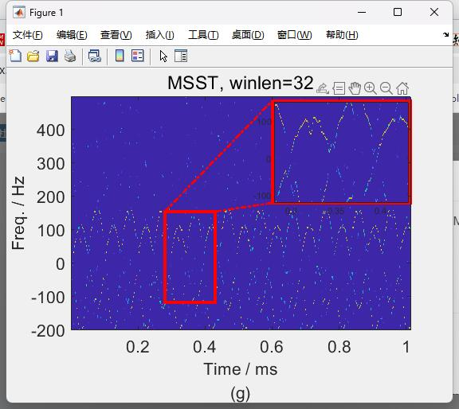

# Multiple Synchronous Compression Transform (MSST) MATLAB Code

MSST is a new time-frequency analysis method proposed by the literature in 2018. MSST first utilizes STFT to obtain the time-frequency distribution of radar signals; then, it performs multiple synchronous compression on the time-frequency distribution to enhance its clustering; finally, it alleviates computational burden through a function iteration optimization algorithm process. As a linear time-frequency tool, MSST does not have cross-term interference, and has broad application prospects in radar signal analysis and processing.
\n        \n  
  

## Images

<!-- PAYMENT_BLOCK -->

## Get this dataset

- Payment link (Stripe): [Buy now](https://buy.stripe.com/3cs8yP7sY87d0vu9AB)
- Payment QR code: 

<!-- /PAYMENT_BLOCK -->
